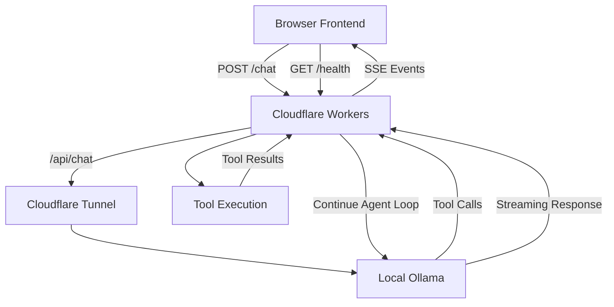

# Qwen 3.5 · Cloudflare AI Agent

**基于 Ollama、Cloudflare Tunnel 与 Cloudflare Workers 的自托管大模型对话应用，支持工具调用、流式响应与网页信息抓取。**

<p align="center">
  
  
  
  
  
</p>

## 项目简介

本项目尝试将本地大语言模型推理能力与云端 Web 服务结合，构建一个可以通过浏览器访问的 AI 对话应用。

项目使用 Ollama 运行 `qwen3.5:9b` 模型，通过 Cloudflare Tunnel 建立本地推理服务与 Cloudflare 网络之间的连接，并利用 Cloudflare Workers 实现聊天请求转发、工具编排和流式响应处理。

与普通的模型聊天页面相比，本项目进一步实现了基于模型工具调用能力的 Agent 执行流程，使模型可以根据用户问题请求调用时间查询、数学计算和网页抓取工具，并结合工具返回结果继续生成回答。

项目主要关注以下技术方向：

- 本地大语言模型部署与远程访问
- Cloudflare Workers 边缘服务开发
- 大模型 Function Calling / Tool Calling
- 基于 Server-Sent Events（SSE）的流式通信
- 前后端接口设计与异步请求处理

## 系统架构



### 核心组件

| 组件 | 职责 |
|---|---|
| Frontend | 提供聊天界面、维护对话历史、解析 SSE 事件 |
| Cloudflare Workers | 处理 HTTP 请求、转发模型调用、编排工具执行、输出事件流 |
| Cloudflare Tunnel | 建立本地 Ollama 服务与 Cloudflare 网络之间的连接 |
| Ollama | 运行大语言模型并生成回答、提出工具调用请求 |
| Agent Tools | 提供时间查询、数学计算和网页文本抓取能力 |

> 架构说明：以上图示描述了设计中的主要请求路径。部署时应根据实际的 Workers 路由、静态资源绑定和 Tunnel 配置核对完整链路。

## 功能特性

### 1. 基于 Ollama 的大模型对话

- 使用 `qwen3.5:9b` 作为默认模型。
- 通过 Ollama `/api/chat` 接口发送对话历史。
- 前端维护当前会话的消息列表，并将历史消息提交给后端。
- 支持连续多轮对话。

### 2. Agent 工具调用

后端向模型提供工具定义，并根据模型返回的 `tool_calls` 执行相应操作。

当前实现了三个工具：

| 工具 | 功能 | 参数 |
|---|---|---|
| `get_current_time` | 获取指定时区的日期和时间 | `timezone` |
| `calculate` | 计算简单数学表达式 | `expression` |
| `fetch_webpage` | 抓取网页并提取纯文本 | `url` |

工具调用流程：

1. 将对话历史与工具定义发送给 Ollama。
2. 检查模型是否返回工具调用请求。
3. 解析工具名称与参数，并执行对应函数。
4. 将工具执行结果加入对话消息列表。
5. 再次请求模型，使其根据工具结果继续推理。
6. 最多执行 5 轮编排循环，随后进入最终回答生成流程。

对于网页抓取工具，后端会移除部分 HTML 标签以及脚本、样式内容，并将返回文本截断至 4000 个字符。

### 3. SSE 流式响应

后端使用 `TransformStream` 和 `ReadableStream` 构建响应流，将工具执行状态与模型生成内容传递给前端。

当前事件类型包括：

| 事件类型 | 用途 |
|---|---|
| `tool` | 通知前端模型正在调用哪个工具 |
| `content` | 返回一段模型生成的文本 |
| `done` | 标记模型响应完成 |
| `error` | 返回处理过程中捕获的错误信息 |

前端通过 `fetch()` 读取响应流，利用 `TextDecoder` 解码数据，并解析 SSE 消息，从而逐步更新对话界面。

这一实现将模型生成、工具调用和前端渲染串联成一个异步处理流程。

### 4. 健康检查

通过 `GET /health` 检查 Ollama 的连接状态与指定模型是否存在。

示例响应：

```json
{
  "ollama": true,
  "model": "qwen3.5:9b",
  "modelAvailable": true
}
```

其中：

- `ollama` 表示健康检查请求是否成功获取 Ollama 模型列表。
- `model` 表示配置的目标模型名称。
- `modelAvailable` 表示目标模型是否出现在模型列表中。

前端根据检查结果展示服务状态，帮助区分 Ollama 不可达与目标模型缺失的情况。

### 5. 前端交互

- 简洁的聊天界面与消息气泡。
- 支持 Enter 发送消息。
- 支持创建新对话。
- 展示工具调用状态。
- 支持基础 Markdown 格式，包括粗体、行内代码和代码块。
- 使用 `AbortController` 中止浏览器侧的请求读取。

## 技术栈

| 技术 | 使用场景 |
|---|---|
| Ollama | 本地大语言模型运行与推理 |
| Qwen 3.5 9B | 默认对话模型 |
| Cloudflare Tunnel | 本地服务的网络连接 |
| Cloudflare Workers | 云端 HTTP 接口与 Agent 编排 |
| JavaScript | 前后端业务逻辑 |
| HTML / CSS | 聊天界面 |
| Fetch API | 前后端 HTTP 通信 |
| Server-Sent Events | 服务端向前端持续推送事件 |
| TransformStream | 后端响应流处理 |

## API 接口

| 接口 | 方法 | 说明 |
|---|---|---|
| `/` | GET | 重定向至聊天页面 |
| `/index.html` | GET | 重定向至聊天页面 |
| `/health` | GET | 检查 Ollama 与目标模型状态 |
| `/chat` | POST | 处理对话请求并返回 SSE 事件流 |

### 聊天请求示例

```http
POST /chat
Content-Type: application/json
```

```json
{
  "messages": [
    {
      "role": "user",
      "content": "现在是几点？"
    }
  ]
}
```

`messages` 为当前会话的消息历史。具体消息结构应符合 Ollama Chat API 的要求。

## 项目结构

```text
.
├── index.js              # Cloudflare Workers 后端
├── qwennine_cloud.html   # 前端聊天页面
└── README.md             # 项目说明
```

当前项目将前端界面与后端逻辑分开放置。前端通过同源路径调用 `/health` 和 `/chat`，后端负责处理请求并连接 Ollama。

## 当前限制

- 默认模型名称与 Ollama 服务地址配置在后端代码中。
- 工具编排最多执行 5 轮循环。
- 网页抓取目前主要依靠简单的 HTML 文本清理，不是完整的网页解析器。
- 前端 Markdown 渲染仅实现基础格式。
- 当前代码未展示完整的身份验证、速率限制和自动化测试方案。
- 浏览器侧中止请求不代表模型端推理任务一定已经停止。

## 后续改进方向

- 增加身份验证、访问控制与请求速率限制。
- 为网页抓取工具增加目标 URL 校验与请求超时控制。
- 为数学计算工具使用安全的表达式解析器。
- 完善 SSE 断流、异常处理与取消逻辑。
- 增加 API 自动化测试和部署验证流程。
- 引入结构化日志、耗时统计与运行监控。
- 将模型、服务地址等配置迁移至合适的环境配置机制。
- 扩展更多可控的 Agent 工具。

## License

尚未指定许可证。公开前请根据代码的来源、使用方式与希望授予他人的权限选择合适的开源许可证。
